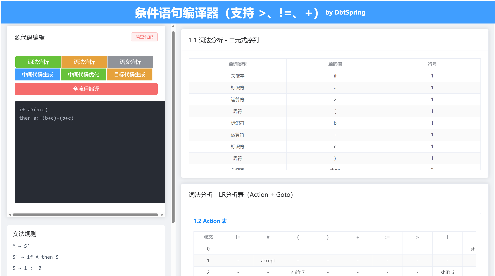

*中文版本介绍：* [跳转](#Chinese)

*English intro:* [GoTo](#English)

# <span id="English">Conditional Statement Compiler Implemented in Java (Supports >, !=, +)</span>

A lightweight compiler implemented in Java that supports the complete compilation process (Lexical Analysis → Syntax Analysis → Semantic Analysis → Intermediate Code Generation → Code Optimization → X86-64 Assembly Generation) for simple conditional statements. It includes exception handling and symbol table management, and provides a visual interactive interface based on Vue + Spring Boot.



## I. Supported Grammar Rules

```
M → S'
S' → if A then S
S → i := B
A → B != B | B > B | B
B → B + F | F
F → i | ( B )
```

- **Terminal Symbols**: `if`, `then`, `:=`, `!=`, `+`, `>`, `(`, `)`, identifier `i`
- **Non-terminal Symbols**: `M`, `S'`, `S`, `A`, `B`, `F`

## II. Compiler Stages and Outputs


**Program Input**: Source code String to be compiled

**Output of Each Interface**: See the table below

| Interface Path         | Output Data Type   | Core Output Content                                          |
| ---------------------- | ------------------ | ------------------------------------------------------------ |
| /compiler/full-compile | TotalProcessResult | Full-process results: Token list, AST (Abstract Syntax Tree), symbol table, original quadruples, optimized quadruples, x86 assembly code |
| /compiler/lex          | LexerResult        | Lexical analysis results: Token pairs (type + value + line number), LR1 analysis table (actionTable/gotoTable) |
| /compiler/syntax       | AnalysisResult     | Syntax analysis results: Abstract Syntax Tree (TreeNode), symbol table (variable type / address / scope), analysis log |
| /compiler/semantic     | SemanticResult     | Semantic analysis results: if structure check results, assignment check results, symbol table list |
| /compiler/ir           | List<Quadruple>    | Intermediate code: list of quadruples (operator, operand 1/2, result, serial number, block ID) |
| /compiler/optimize     | OptimizedResult    | Optimization results: partitioned quadruples, list of quadruples after intra-block optimization (constant folding / expression reuse) |
| /compiler/codeGen      | String             | 64-bit x86 assembly code (including data segment, code segment, exit logic; can be compiled and executed directly) |

## III. Usage Guide

### 1. Environment Installation

Use versions no lower than the "environment examples" below. Installation tutorials can be found online.

Environment Examples:

- Frontend: Node.js 24.12.0, npm 11.6.2, Vue 3, Vite
- Backend: JDK 17, Spring Boot 3.2.1
- Development Tools: VS Code, IntelliJ IDEA (Lombok plugin required)

### 2. Clone Repository / Download Code

Open the terminal and execute the following commands:

```bash
# Set REPOSITORY_URL to your clone URL first
git clone "$REPOSITORY_URL" simple-condition-compiler
# Enter the project root directory
cd simple-condition-compiler
```

Alternatively, click the download button to download the code to your local machine.

### 3. Install Frontend Dependencies and Start the Service

```bash
# Enter the frontend directory
cd compiler-front
# Install dependencies (execute only for the first run, no need to repeat later)
npm install
# Start the frontend development server
npm run dev
```

The frontend service runs at http://localhost:5173.

### 4. Start the Backend Service

Open `compiler-backend` with IntelliJ IDEA and run the `CompilerBackendApplication` class.

The backend service runs at http://localhost:8080.

### 5. Access the Frontend Page

Visit the following address in your browser: http://localhost:5173

Test the functionality with the provided test cases.

## IV. Comprehensive Test Cases

### 1. ✔️ Valid Data

**Includes**: Lexical Analysis + Syntax Analysis + Semantic Analysis + Intermediate Code Generation + Target Code Generation

**Excludes**: Intermediate Code Optimization (tested separately later)

**1.1 Data Without Parentheses**:

```
if score>maxScore
then maxScore:=score
```

**1.2 Data With Parentheses**:

```
if priceC!=(priceA+priceB)
then priceC:=(priceA + 1)
```

### 2. ✖️ Partially Invalid Data

**2.1** Lexically Invalid (contains undefined operator @) → **Lexical Analysis Exception**

```
if a@b then a:=b
```

### 3. ✖️ Totally Invalid Data

**3.1** Missing Core Keyword (no "if") → **Syntax Analysis Exception**

```
a>b+c then d:=a
```

**3.2** Disordered if-then Structure → **Syntax Analysis Exception**

```
a:=b+c>d if then
```

### 4. ✖️ Counterexamples for Semantic Analysis Errors

**4.1 Conditional Expression is Non-Boolean Type**

```
if a+1 then a:=a+1
```

**4.2 Left Side of Assignment is Not a Variable (e.g., a number)**

```
if a>1 then 21:=a+1
```

### 5. ✔️ Positive Examples for Quadruple Optimization:

**5.1 Basic Block Partitioning**

**5.2 Intra-block Optimization**: Constant folding for comparison operations + removal of useless branches after if

```
if 5>10 then x:=i+3
```

**5.3 Intra-block Optimization**: Merging or reusing temporary variables

```
if a>(b+c)then a:=(b+c)+(b+c)
```


# <span id="Chinese">Java实现的条件语句编译器（支持 >、!=、+）</span>

一个Java实现的轻量级编译器，支持对简单条件语句进行完整编译流程（词法分析→语法分析→语义分析→中间代码生成→代码优化→X86-64 汇编生成），包含异常处理和符号表管理。并基于 Vue + Spring Boot提供可视化交互界面。


## 一、支持的文法规则

```
M → S'
S' → if A then S
S → i := B
A → B != B | B > B | B
B → B + F | F
F → i | ( B )
```

- 终结符：`if`、`then`、`:=`、`!=`、`+`、`>`、`(`、`)`、标识符`i`
- 非终结符：`M`、`S'`、`S`、`A`、`B`、`F`

## 二、详细程序设计和测试结果


**程序输入：**要编译的源代码String

**各接口输出：**见表格

|        接口路径        |   输出 data 类型   |                         核心输出内容                         |
| :--------------------: | :----------------: | :----------------------------------------------------------: |
| /compiler/full-compile | TotalProcessResult | 全流程结果：Token 列表、AST 语法树、符号表、原始四元式、优化后四元式、x86 汇编代码 |
|     /compiler/lex      |    LexerResult     | 词法分析结果：Token 二元式（类型 + 值 + 行号）、LR1 分析表（actionTable/gotoTable） |
|    /compiler/syntax    |   AnalysisResult   | 语法分析结果：抽象语法树（TreeNode）、符号表（变量类型 / 地址 / 作用域）、分析日志 |
|   /compiler/semantic   |   SemanticResult   |   语义分析结果：if 结构检查结果、赋值检查结果、符号表列表    |
|      /compiler/ir      |  List<Quadruple>   | 中间代码：四元式列表（操作符、操作数 1/2、结果、序号、块编号） |
|   /compiler/optimize   |  OptimizedResult   | 优化结果：分块四元式、块内优化（常量合并 / 表达式复用）后的四元式列表 |
|   /compiler/codeGen    |       字符串       | 64 位 x86 汇编代码（含数据段、代码段、退出逻辑，可直接编译执行） |

## 三、使用指南

### 1.环境安装

不低于“环境示例”的版本，可以网上搜安装教程

环境示例：

- 前端：Node.js 24.12.0 、npm 11.6.2、Vue 3、Vite
- 后端：JDK 17、Spring Boot 3.2.1
- 开发工具：vsCode、idea（需要安装lombok插件）

### 2.克隆仓库/下载代码

打开终端，执行以下命令：

```bash
# 克隆仓库
git clone "$REPOSITORY_URL" simple-condition-compiler
# 进入项目根目录
cd simple-condition-compiler
```

或者直接点下载按钮，下载代码到本地

### 3.安装前端依赖并启动

```bash
# 进入前端目录
cd compiler-front
# 安装依赖（首次运行需执行，后续无需重复安装）
npm install
# 启动前端开发服务器
npm run dev
```

前端服务运行在 http://localhost:5173

### 4.启动并后端

用idea打开compiler-backend，并运行CompilerBackendApplication类

后端服务运行在http://localhost:8080

### 5.访问前端页面

浏览器访问：http://localhost:5173

用测试用例测试功能


## 四、全面的测试用例

### 1. ✔️合法数据

**包含**：词法分析+语法分析+语义分析+中间代码生成+目标代码生成，

**不包含**：中间代码优化，后面单独测试

**1.1 不含括号数据：**

```
if score>maxScore
then maxScore:=score
```

**1.2 含括号数据：**

```
if priceC!=(priceA+priceB)
then priceC:=(priceA + 1)
```

### 2. ✖️局部非法数据

**2.1** 词法非法（含未定义运算符@） ->**词法分析异常**

```
if a@b then a:=b
```

### 3. ✖️整体非法数据

**3.1** 缺失核心关键字（无 if）->**语法分析异常**

```
a>b+c then d:=a
```

3.2 if then结构混乱 ->**语法分析异常**

```
a:=b+c>d if then
```

### 4. ✖️语义分析错误反例

**4.1 条件表达式非布尔类型**

```
if a+1 then a:=a+1
```

**4.2 赋值式子左边非变量（如数字）**

```
if a>1 then 21:=a+1
```

### 5. ✔️四元式优化正例**：**

**5.1 基本块划分**

**5.2 块内优化**：比较运算的常量合并 + 去除if后无用的分支

```
if 5>10 then x:=i+3
```

**5.3 块内优化：**合并或复用临时变量

```
if a>(b+c)then a:=(b+c)+(b+c)
```


---

